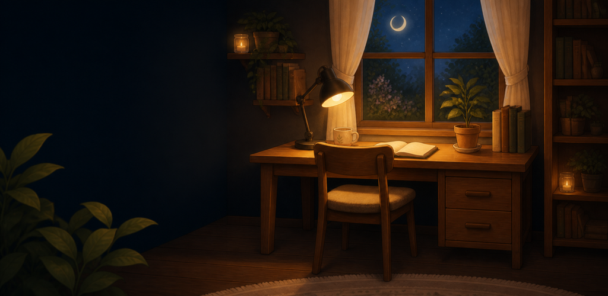
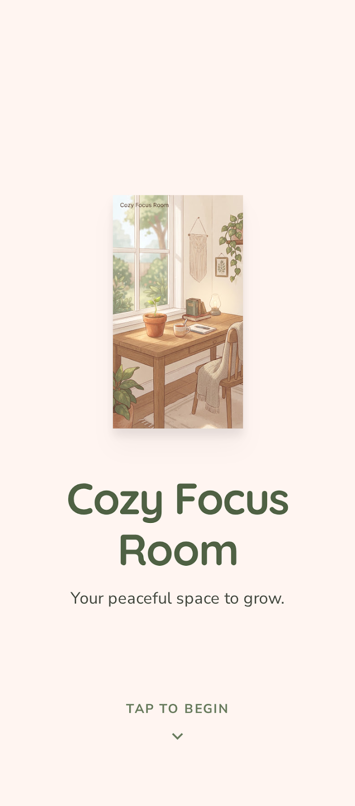
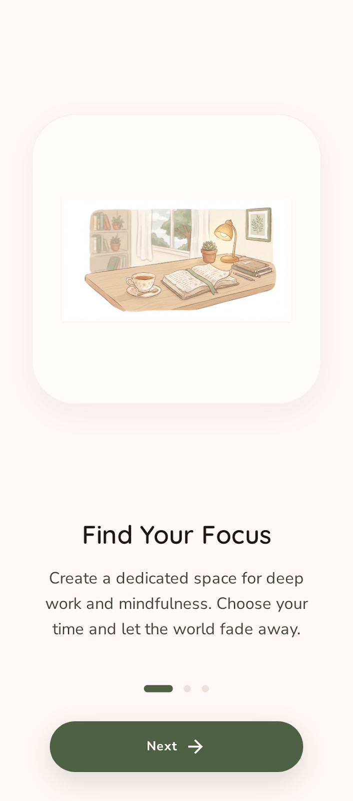
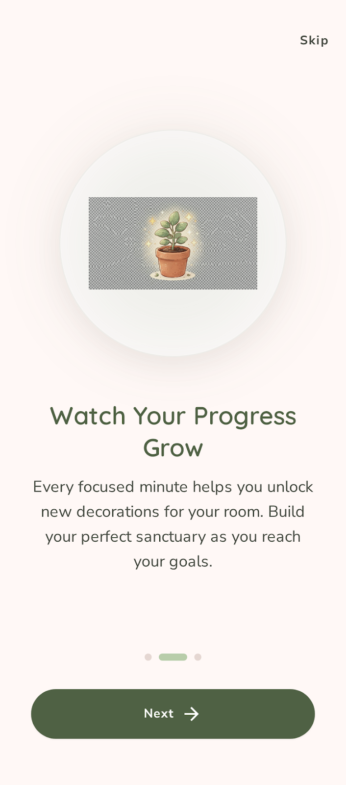
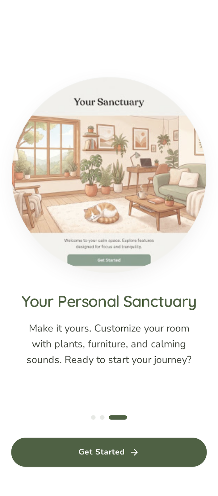
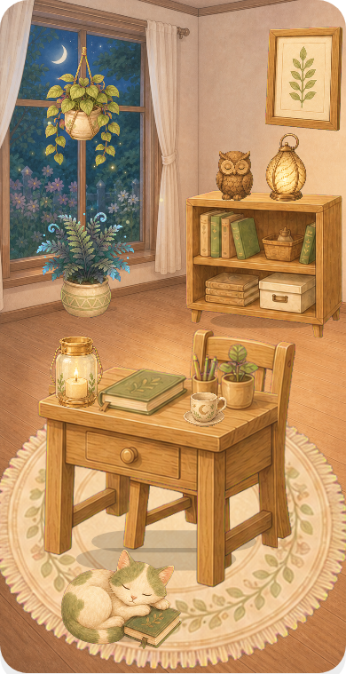

<div align="center">

  

  # 🌿 Cozy Focus Room

  **A calm, gamified Pomodoro focus timer that turns completed sessions into living room decorations.**

  [](https://flutter.dev)
  [](https://dart.dev)
  [](https://firebase.google.com)
  [](#-license--copyright)
  [](#)
  [](#-internationalization)

  [Features](#-key-features) •
  [Screenshots](#-screenshots) •
  [Architecture](#-architecture) •
  [Tech Stack](#-tech-stack) •
  [Getting Started](#-getting-started) •
  [Security](#-security--firebase-setup)

</div>

---

## 📖 About Cozy Focus

**Cozy Focus Room** reimagines productivity through gentle mindfulness. Rather than pressuring you with harsh alarms and rigid metrics, it rewards your focus time by gradually furnishing and decorating a cozy, animated personal room. 

Each focused minute contributes crafting progress toward handcrafted room assets—such as a warm desk, a cozy armchair, lush plants, a sleeping cat, and soft lantern glow. Combined with a multi-track ambient audio mixer and custom focus rituals, Cozy Focus helps you build a distraction-free sanctuary for deep work and study.

---

## ✨ Key Features

### 🎯 Pomodoro & Focus Timer
- **Flexible Durations:** Configurable focus intervals (15, 25, 45, 60, 75, 90 mins) and breaks (5, 10, 15 mins).
- **Gentle Goal Tracking:** Daily targets (60–480 mins) with visual progress ring and completion celebrations.
- **Auto-Start Breaks & Reminders:** Smooth transitions between focus and rest sessions.

### 🏠 Gamified Room & Crafting System
- **Living Illustrated Canvas:** Layered sprite rendering with animated atmospheric effects (fireflies, swaying plants, lantern glows).
- **Milestone Unlocks:** 8 main items (Desk, Chair, Botanical Rug, Bookshelf, Candle, Wall Art, Hanging Plant, Sleeping Cat) crafted over time.
- **Daily Collectibles:** 4 special rewards (Moon Tea, Night Fern, Owl Figure, Leaf Lantern) for reaching daily goals.
- **Interactive Room Elements:** Tap objects to toggle lighting and interact with room items.

### 🧘 Focus Rituals
- **Pre-configured Rituals:** Instant presets for *Study*, *Reading*, and *Deep Focus*.
- **Custom Ritual Builder:** Create up to 5 personalized rituals combining target durations and tailored ambient soundscapes.

### 🎵 Multi-Track Ambient Mixer
- **Layered Soundscapes:** Independent playback and volume control for Rain, Campfire, Deep Forest, and Soft Piano.
- **Sleep & Session Timer:** Built-in sleep timer with auto-fadeout.
- **Tactile Sound Feedback:** Gentle UI clicks, wood-carving, and reward feedback sounds.

### 📊 Insights & Streaks
- **Weekly Rhythm:** Animated bar charts showing daily breakdown (Mon–Sun).
- **Streak & Totals:** Track consecutive active days, total minutes, and milestone records.

### 👤 Profile & Badges
- **Custom Avatars & Username:** 6 illustrated avatars representing cozy companion motifs.
- **8 Achievement Badges:** Earn milestones from *First Bloom* to *Sanctuary Complete*.

### ☁️ Local-First with Cloud Sync
- **Seamless Guest Mode:** Works immediately offline out of the box using `SharedPreferences`.
- **Firebase Authentication & Firestore Sync:** Link with Google or Email/Password to sync progress across devices.

### 🌍 Internationalization
- Fully localized in **English** and **Turkish** with instant in-app language switching.

---

## 📱 Screenshots

<div align="center">
  <table>
    <tr>
      <td align="center"><b>Welcome Splash</b></td>
      <td align="center"><b>Find Your Focus</b></td>
      <td align="center"><b>Watch It Grow</b></td>
    </tr>
    <tr>
      <td></td>
      <td></td>
      <td></td>
    </tr>
    <tr>
      <td align="center"><b>Your Sanctuary</b></td>
      <td align="center"><b>Living Room Composition</b></td>
      <td align="center"><b>Decorated Room</b></td>
    </tr>
    <tr>
      <td></td>
      <td></td>
      <td></td>
    </tr>
  </table>
</div>

---

## 🏛️ Architecture

The app follows clean Flutter architectural practices centered around a **reactive controller pattern** with service injection:

```
lib/
├── core/
│   ├── assets/       # Sprite atlas definitions, audio and visual mappings
│   ├── models/       # Immutable domain models (AppProgress, DecorationItem, FocusRitual, etc.)
│   ├── services/     # Contracts & implementations (AudioService, ProgressRepository, AccountService)
│   ├── theme/        # AppColors, DesignTokens, Material 3 AppTheme (Light & Dark)
│   └── widgets/      # Shared components (AppScope, CozyCard, TapSoundRegion, AtlasSprite)
├── features/
│   ├── focus/        # Focus timer, ritual widgets, celebration flows
│   ├── room/         # Interactive room canvas, inventory grid, placement logic
│   ├── stats/        # Weekly rhythm chart, streak tracking, history
│   ├── sounds/       # Ambient audio mixer, sound cards, sleep timer
│   ├── profile/      # Avatars, username, achievement badge system
│   ├── settings/     # Preference toggles, language picker, account & cloud sync
│   └── onboarding/   # Splash screen & first-run onboarding sequence
├── l10n/             # ARB localization definitions and generated localization delegates
└── main.dart         # Service bootstrapping, dependency injection & app entrypoint
```

### State Management
- **`AppController` (`ChangeNotifier`)**: Central state container handling session intervals, room inventories, audio mixing, and sync triggers.
- **`AppScope` (`InheritedNotifier`)**: Provides widget tree access without heavy third-party boilerplate.
- **Repository Abstraction**: Dual repository pattern allowing seamless switching between local storage (`SharedPreferencesProgressRepository`) and cloud persistence (`FirebaseProgressRepository`).

---

## 🛠️ Tech Stack

| Domain | Technology / Package | Description |
|---|---|---|
| **Framework** | [Flutter SDK](https://flutter.dev) (v3.11.5+) | Cross-platform UI toolkit |
| **Language** | [Dart](https://dart.dev) | Strongly typed client language |
| **Audio Engine** | [`just_audio`](https://pub.dev/packages/just_audio) & [`audio_session`](https://pub.dev/packages/audio_session) | Multi-channel concurrent audio playback with background session management |
| **Cloud & Auth** | [`firebase_core`](https://pub.dev/packages/firebase_core), [`firebase_auth`](https://pub.dev/packages/firebase_auth), [`cloud_firestore`](https://pub.dev/packages/cloud_firestore) | User authentication (Anonymous, Email, Google) and document-based data sync |
| **Security** | [`firebase_app_check`](https://pub.dev/packages/firebase_app_check) | Device attestation & backend protection |
| **OAuth** | [`google_sign_in`](https://pub.dev/packages/google_sign_in) | Native Google authentication |
| **Local Cache** | [`shared_preferences`](https://pub.dev/packages/shared_preferences) | Fast offline key-value state persistence |
| **Typography** | Quicksand & Nunito Sans | Bundled Google Fonts (SIL Open Font License) |

---

## 🚀 Getting Started

### Prerequisites
- [Flutter SDK](https://docs.flutter.dev/get-started/install) (`>= 3.11.5`)
- Dart SDK (`>= 3.11.5`)
- Xcode (for iOS/macOS) or Android Studio (for Android)

### Installation

1. **Clone the repository:**
   ```bash
   git clone https://github.com/sahinsanli/CozyFocus.git
   cd CozyFocus
   ```

2. **Install dependencies:**
   ```bash
   flutter pub get
   ```

3. **Run the app:**
   ```bash
   flutter run
   ```

---

## 🔐 Security & Firebase Setup

For production or personal deployments with cloud sync enabled:

1. **Configure Firebase:**
   Create a new project in the [Firebase Console](https://console.firebase.google.com) and configure it using the FlutterFire CLI:
   ```bash
   dart pub global activate flutterfire_cli
   flutterfire configure
   ```

2. **Android Keystore Configuration:**
   Copy the template signing configuration:
   ```bash
   cp android/key.properties.example android/key.properties
   ```
   Fill in your keystore path, alias, and secure passwords. `key.properties` and `*.p12`/`*.keystore` files are explicitly excluded via `.gitignore`.

3. **Firestore Security Rules:**
   Apply the hardened rules located at `firestore.rules`. The rules enforce strict user-ownership validation:
   ```bash
   firebase deploy --only firestore:rules
   ```

---

## 🧪 Testing & Verification

Run the test suite and verify code quality:

```bash
# Static analysis
flutter analyze

# Unit & Widget tests
flutter test

# Build debug APK
flutter build apk --debug
```

---

## 📄 License & Copyright

**Copyright © 2026 Şahin Şanlı. All Rights Reserved.**

This repository is publicly shared **strictly for portfolio, demonstration, and personal showcase purposes**. 

Unauthorized copying, distribution, modification, reverse engineering, commercial use, or republication of any code, artwork, audio assets, or design elements is strictly prohibited without prior written consent from the author.

---

<div align="center">
  <sub>Crafted with calm and mindfulness by <a href="https://github.com/sahinsanli">Şahin Şanlı</a>.</sub>
</div>
